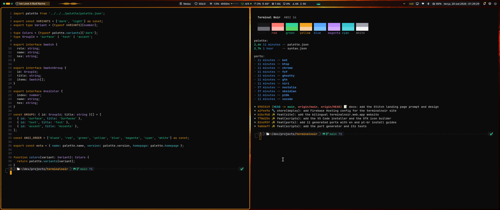

# Terminal Noir

A dark theme of cold near-black surfaces, stepped by luminance, with one warm amber accent and an emerald status color. A light variant follows the same roles on warm paper tones.

Terminal Noir started as the design tokens of [nandomoreira.dev](https://nandomoreira.dev) and grew into a theme for the whole desktop: shell, compositor, terminal, editor, browser and CLI tools.



## Palette

### Dark

| Role | Hex | Used for |
|---|---|---|
| `surface.base` | `#0B0B0C` | window and editor background |
| `surface.raised` | `#121214` | inputs, widgets, line highlight |
| `surface.elevated` | `#18181B` | toolbars, active tab, cards |
| `surface.border` | `#222226` | hairlines |
| `surface.outline` | `#3F3F46` | borders that delimit targets |
| `surface.selection` | `#52525B` | text selection |
| `text.primary` | `#F4F4F5` | body text |
| `text.muted` | `#A1A1AA` | secondary text, comments |
| `text.faint` | `#6B6B74` | line numbers, disabled |
| `accent.primary` | `#F5A623` | the amber accent: cursor, focus, keywords |
| `accent.success` | `#34D399` | success, strings, git clean |
| `accent.warning` | `#FACF9E` | warnings, numbers, git modified |
| `accent.error` | `#FFB7B0` | errors, deletions |
| `accent.info` | `#79C0FF` | info, functions, links |

### Light

| Role | Hex |
|---|---|
| `surface.base` | `#FBFAF7` |
| `surface.raised` | `#F1EFEA` |
| `surface.elevated` | `#E9E6DF` |
| `text.primary` | `#1C1A17` |
| `text.muted` | `#5E5A53` |
| `accent.primary` | `#865700` |
| `accent.success` | `#047857` |
| `accent.error` | `#B42318` |

The full palette, including the 16 ANSI colors of each variant, lives in [`palette/palette.json`](palette/palette.json). Syntax roles live in [`palette/syntax.json`](palette/syntax.json) and point at palette names, never at raw hex.

## Ports

| App | Variants | Port |
|---|---|---|
| Noctalia shell | dark, light | [ports/noctalia](ports/noctalia) |
| niri | dark | [ports/niri](ports/niri) |
| Ghostty | dark, light | [ports/ghostty](ports/ghostty) |
| VS Code / Cursor | dark | [ports/vscode](ports/vscode) |
| GTK 4 / libadwaita | dark | [ports/gtk](ports/gtk) |
| Google Chrome | dark | [ports/chrome](ports/chrome) |
| bat (and delta) | dark | [ports/bat](ports/bat) |
| btop | dark | [ports/btop](ports/btop) |
| fzf | dark | [ports/fzf](ports/fzf) |
| Powerlevel10k | dark | [ports/p10k](ports/p10k) |
| Obsidian | dark | [ports/obsidian](ports/obsidian) |

Each port's README explains how to install it.

## Development

Every port is generated from the palette, so colors are edited in one place:

```sh
make build   # regenerate ports/ from palette/
make test    # palette checks, port mappings, build freshness
make lint    # shellcheck the scripts
```

Requirements: `bash`, `jq`, [`bats-core`](https://github.com/bats-core/bats-core) for tests, `bsdtar` to package the VS Code extension. See [CONTRIBUTING.md](CONTRIBUTING.md) to add a port.

## Website

[`site/`](site) is the terminalnoir.web.app website (Astro, static). It reads `palette/palette.json`, `ports.json` and each port's README at build time, so it always matches the theme.

```sh
cd site
npm install
npm run verify   # astro check, unit tests, build
```

## License

[MIT](LICENSE)
