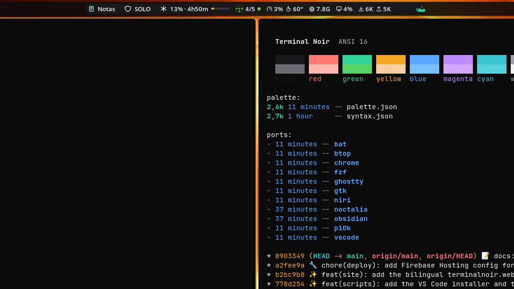

# Terminal Noir

Cold near-black surfaces, one amber accent. One palette, generated into every app you use.

[English](README.md) · [Português](README.pt-br.md)



Status: `0.3.1`, before 1.0. Colors can still change between releases.

## Why

If you spend the day in a terminal, an editor and a browser, each one ships its own idea of "dark", and a desktop themed app by app drifts apart: a color tweak means editing a dozen files by hand, and some of them always get missed. Big themes such as Dracula and Catppuccin solve the "everywhere" part with many hues. Terminal Noir keeps to one warm note: surfaces step by luminance, amber marks only where the eye should go, and every port is generated from a single `palette.json`, so a change lands in every app at once and the tests catch any drift.

## Install

Clone the repo, then copy the files of the port you want. Ghostty, for example:

```sh
git clone https://github.com/nandomoreirame/terminalnoir.git
cd terminalnoir/ports/ghostty
mkdir -p ~/.config/ghostty/themes
cp terminal-noir-dark terminal-noir-light ~/.config/ghostty/themes/
```

The port files are committed, so installing one never requires running the build.

## Usage

Turn the theme on in the app's own config. For Ghostty, add this line to `~/.config/ghostty/config` to follow the system light/dark preference:

```
theme = light:terminal-noir-light,dark:terminal-noir-dark
```

New windows pick it up; reload open ones with `Ctrl+Shift+,`. Each port's README has the equivalent step for its app.

## Ports

| App | Variants | Port |
|---|---|---|
| Noctalia shell | dark, light | [ports/noctalia](ports/noctalia) |
| niri | dark | [ports/niri](ports/niri) |
| GTK 4 / libadwaita | dark | [ports/gtk](ports/gtk) |
| Ghostty | dark, light | [ports/ghostty](ports/ghostty) |
| kitty | dark, light | [ports/kitty](ports/kitty) |
| Alacritty | dark, light | [ports/alacritty](ports/alacritty) |
| iTerm2 | dark, light | [ports/iterm2](ports/iterm2) |
| Hyper | dark, light | [ports/hyper](ports/hyper) |
| zsh (syntax highlighting) | dark, light | [ports/zsh](ports/zsh) |
| fish | dark, light | [ports/fish](ports/fish) |
| Powerlevel10k | dark | [ports/p10k](ports/p10k) |
| Neovim / Vim | dark, light | [ports/nvim](ports/nvim) |
| VS Code / Cursor | dark | [ports/vscode](ports/vscode) |
| micro | dark, light | [ports/micro](ports/micro) |
| Obsidian | dark | [ports/obsidian](ports/obsidian) |
| Shiki | dark, light | [ports/shiki](ports/shiki) |
| bat (and delta) | dark | [ports/bat](ports/bat) |
| btop | dark | [ports/btop](ports/btop) |
| fzf | dark | [ports/fzf](ports/fzf) |
| presenterm | dark, light | [ports/presenterm](ports/presenterm) |
| Google Chrome | dark | [ports/chrome](ports/chrome) |
| Zen Browser | dark, light | [ports/zen](ports/zen) |
| Telegram Desktop | dark, light | [ports/telegram](ports/telegram) |

Every port has install steps in English (`README.md`) and Portuguese (`README.pt-br.md`). The website, [terminalnoir.web.app](https://terminalnoir.web.app), shows the same list with screenshots.

## Palette

### Dark

| Role | Hex | Used for |
|---|---|---|
| `surface.base` | `#0B0B0C` | window and editor background |
| `surface.raised` | `#121214` | inputs, widgets, line highlight |
| `surface.elevated` | `#18181B` | toolbars, active tab, cards |
| `surface.border` | `#222226` | hairlines |
| `surface.outline` | `#64646B` | borders that delimit targets |
| `surface.selection` | `#52525B` | text selection |
| `text.primary` | `#F4F4F5` | body text |
| `text.muted` | `#A1A1AA` | secondary text, comments |
| `text.faint` | `#6B6B74` | line numbers, disabled |
| `accent.primary` | `#F5A623` | the amber accent: cursor, focus, keywords |
| `accent.success` | `#34D399` | success, strings, git clean |
| `accent.warning` | `#FACF9E` | warnings, numbers, git modified |
| `accent.error` | `#FFB7B0` | errors, deletions |
| `accent.info` | `#79C0FF` | info, functions, links |

### Light

| Role | Hex |
|---|---|
| `surface.base` | `#FBFAF7` |
| `surface.raised` | `#F1EFEA` |
| `surface.elevated` | `#E9E6DF` |
| `text.primary` | `#1C1A17` |
| `text.muted` | `#5E5A53` |
| `accent.primary` | `#865700` |
| `accent.success` | `#0B7656` |
| `accent.error` | `#B42318` |

The full palette, including the 16 ANSI colors of each variant, lives in [`palette/palette.json`](palette/palette.json). Syntax roles live in [`palette/syntax.json`](palette/syntax.json) and point at palette roles, never at raw hex.

## Accessibility

Both variants meet WCAG 2.1 AA on every surface (`base`, `raised`, `elevated`): text, accents, syntax roles and ANSI colors at 4.5:1, `text.faint` and `surface.outline` at 3:1. `surface.border` is a decorative hairline and never the only cue. The background slot of each ANSI set (`black` in dark, bright `white` in light) is exempt. [`tests/contrast.bats`](tests/contrast.bats) fails the build when a color drops below its floor.

## Development

Requirements: `bash`, `jq`, [`bats-core`](https://github.com/bats-core/bats-core) for tests, `shellcheck` for lint, `bsdtar` to package the VS Code extension.

```sh
make build   # regenerate ports/ from palette/
make test    # palette checks, contrast, port mappings, build freshness
make lint    # shellcheck the scripts
```

To change a color, edit `palette/palette.json`, run `make build test` and commit the palette together with the regenerated ports. [CONTRIBUTING.md](CONTRIBUTING.md) explains how to add a port.

## Repository scope

- `palette/`: the source of truth (colors and syntax roles).
- `scripts/`: the generator (one `scripts/ports/<app>.sh` per port) plus two installers, `install-vscode` and `build-gtk-icons`.
- `ports/`: generated files, committed so they install without a build.
- `site/`: the [terminalnoir.web.app](https://terminalnoir.web.app) website (Astro, static). It lives here because it reads `palette/palette.json`, `ports.json` and each port's README at build time, so it cannot drift from the theme.

```sh
cd site
npm install
npm run verify   # astro check, unit tests, build
```

## Security

The ports are color files. A few are code that your app runs when it loads the theme: the Hyper plugin (`index.js`), the Neovim Lua and Vim colorschemes, the zsh, fzf and Powerlevel10k shell files you `source`, and the Zen Browser CSS. None of them makes network requests, reads secrets or runs other programs; read them before installing, as with any dotfile.

The scripts run locally and never touch the network:

- `scripts/build` reads `palette/` with `jq` and writes only under `ports/` (or the directory you pass).
- `scripts/install-vscode` packages `ports/vscode` as a VSIX and runs `code --install-extension` and `cursor --install-extension`.
- `scripts/build-gtk-icons` reads the installed Adwaita icons and writes a recolored copy to `~/.local/share/icons/Terminal-Noir`.

The website is static, served by Firebase Hosting with `nosniff`, `X-Frame-Options: DENY` and a restrictive `Permissions-Policy`. CI deploys it from `main` only, with keyless Workload Identity Federation instead of a stored key.

Report a problem by opening a [GitHub issue](https://github.com/nandomoreirame/terminalnoir/issues).

## Contributing

Issues and pull requests are welcome, including new ports. Start with [CONTRIBUTING.md](CONTRIBUTING.md) ([Português](CONTRIBUTING.pt-br.md)).

## Acknowledgements

Terminal Noir is the theme of [nandomoreira.dev](https://nandomoreira.dev), extracted from the site's CSS. It borrows its shape from [Dracula](https://draculatheme.com), for one confident identity that goes everywhere, and [Catppuccin](https://catppuccin.com), for treating the palette as the product, with named roles and generated ports.

## License

[MIT](LICENSE) © 2026 Fernando Moreira
