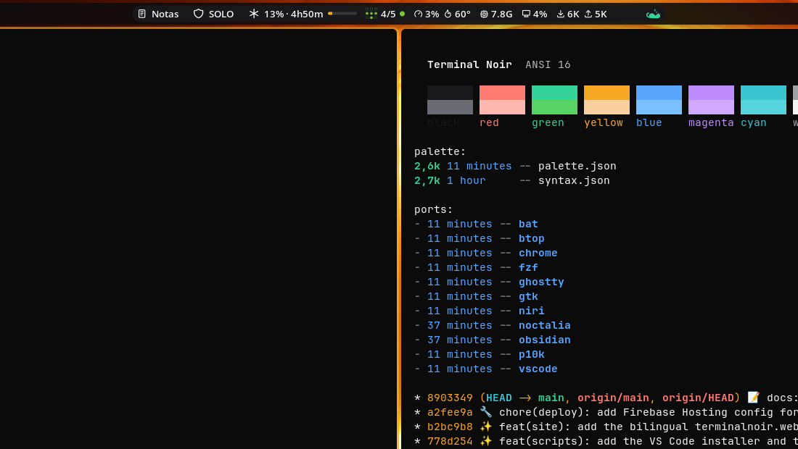

# Terminal Noir

Superfícies frias quase pretas e um único acento âmbar. Uma paleta, gerada para cada app que você usa.

[English](README.md) · [Português](README.pt-br.md)



Status: `0.3.1`, antes da 1.0. As cores ainda podem mudar entre versões.

## Por quê

Quem passa o dia num terminal, num editor e num navegador recebe de cada um uma ideia própria de "escuro", e um desktop tematizado app por app se desencontra: ajustar uma cor significa editar uma dúzia de arquivos à mão, e sempre sobra algum. Temas grandes como Dracula e Catppuccin resolvem o "em todo lugar" com muitos matizes. O Terminal Noir fica com uma nota quente só: as superfícies variam por luminância, o âmbar aparece apenas onde o olho deve ir, e cada port é gerado a partir de um único `palette.json`. Assim uma mudança chega a todos os apps de uma vez, e os testes pegam qualquer desvio.

## Instalação

Clone o repositório e copie os arquivos do port que você quer. No Ghostty, por exemplo:

```sh
git clone https://github.com/nandomoreirame/terminalnoir.git
cd terminalnoir/ports/ghostty
mkdir -p ~/.config/ghostty/themes
cp terminal-noir-dark terminal-noir-light ~/.config/ghostty/themes/
```

Os arquivos dos ports ficam versionados, então instalar um nunca exige rodar o build.

## Uso

Ative o tema na configuração do próprio app. No Ghostty, adicione esta linha em `~/.config/ghostty/config` para seguir a preferência clara/escura do sistema:

```
theme = light:terminal-noir-light,dark:terminal-noir-dark
```

Janelas novas já abrem com o tema; recarregue as abertas com `Ctrl+Shift+,`. O README de cada port traz o passo equivalente para o app dele.

## Ports

| App | Variantes | Port |
|---|---|---|
| Shell Noctalia | escura, clara | [ports/noctalia](ports/noctalia) |
| niri | escura | [ports/niri](ports/niri) |
| GTK 4 / libadwaita | escura | [ports/gtk](ports/gtk) |
| Ghostty | escura, clara | [ports/ghostty](ports/ghostty) |
| kitty | escura, clara | [ports/kitty](ports/kitty) |
| Alacritty | escura, clara | [ports/alacritty](ports/alacritty) |
| iTerm2 | escura, clara | [ports/iterm2](ports/iterm2) |
| Hyper | escura, clara | [ports/hyper](ports/hyper) |
| zsh (realce de sintaxe) | escura, clara | [ports/zsh](ports/zsh) |
| fish | escura, clara | [ports/fish](ports/fish) |
| Powerlevel10k | escura | [ports/p10k](ports/p10k) |
| Neovim / Vim | escura, clara | [ports/nvim](ports/nvim) |
| VS Code / Cursor | escura | [ports/vscode](ports/vscode) |
| micro | escura, clara | [ports/micro](ports/micro) |
| Obsidian | escura | [ports/obsidian](ports/obsidian) |
| Shiki | escura, clara | [ports/shiki](ports/shiki) |
| bat (e delta) | escura | [ports/bat](ports/bat) |
| btop | escura | [ports/btop](ports/btop) |
| fzf | escura | [ports/fzf](ports/fzf) |
| presenterm | escura, clara | [ports/presenterm](ports/presenterm) |
| /dev/null | escura, clara | [ports/devnull](ports/devnull) |
| Google Chrome | escura | [ports/chrome](ports/chrome) |
| Zen Browser | escura, clara | [ports/zen](ports/zen) |
| Telegram Desktop | escura, clara | [ports/telegram](ports/telegram) |

Cada port tem instruções de instalação em inglês (`README.md`) e em português (`README.pt-br.md`). O site, [terminalnoir.web.app](https://terminalnoir.web.app), mostra a mesma lista com screenshots.

## Paleta

### Escura

| Papel | Hex | Uso |
|---|---|---|
| `surface.base` | `#0B0B0C` | fundo de janelas e do editor |
| `surface.raised` | `#121214` | campos, widgets, linha atual |
| `surface.elevated` | `#18181B` | barras de ferramentas, aba ativa, cards |
| `surface.border` | `#222226` | linhas finas |
| `surface.outline` | `#64646B` | bordas que delimitam alvos |
| `surface.selection` | `#52525B` | seleção de texto |
| `text.primary` | `#F4F4F5` | texto principal |
| `text.muted` | `#A1A1AA` | texto secundário, comentários |
| `text.faint` | `#6B6B74` | números de linha, desabilitado |
| `accent.primary` | `#F5A623` | o acento âmbar: cursor, foco, palavras-chave |
| `accent.success` | `#34D399` | sucesso, strings, git limpo |
| `accent.warning` | `#FACF9E` | avisos, números, git modificado |
| `accent.error` | `#FFB7B0` | erros, remoções |
| `accent.info` | `#79C0FF` | informação, funções, links |

### Clara (Paper)

| Papel | Hex |
|---|---|
| `surface.base` | `#FBFAF7` |
| `surface.raised` | `#F1EFEA` |
| `surface.elevated` | `#E9E6DF` |
| `text.primary` | `#1C1A17` |
| `text.muted` | `#5E5A53` |
| `accent.primary` | `#865700` |
| `accent.success` | `#0B7656` |
| `accent.error` | `#B42318` |

A paleta completa, com as 16 cores ANSI de cada variante, está em [`palette/palette.json`](palette/palette.json). Os papéis de sintaxe ficam em [`palette/syntax.json`](palette/syntax.json) e apontam para papéis da paleta, nunca para um hex direto.

## Acessibilidade

As duas variantes atendem ao WCAG 2.1 AA em todas as superfícies (`base`, `raised`, `elevated`): texto, acentos, papéis de sintaxe e cores ANSI a 4,5:1, `text.faint` e `surface.outline` a 3:1. `surface.border` é uma linha decorativa e nunca a única pista visual. O slot de fundo de cada conjunto ANSI (`black` no escuro, `white` brilhante no claro) fica de fora. O [`tests/contrast.bats`](tests/contrast.bats) quebra o build quando uma cor cai abaixo do mínimo.

## Desenvolvimento

Requisitos: `bash`, `jq`, [`bats-core`](https://github.com/bats-core/bats-core) para os testes, `shellcheck` para o lint e `bsdtar` para empacotar a extensão do VS Code.

```sh
make build   # regenerate ports/ from palette/
make test    # palette checks, contrast, port mappings, build freshness
make lint    # shellcheck the scripts
```

Para mudar uma cor, edite `palette/palette.json`, rode `make build test` e faça o commit da paleta junto com os ports regenerados. O [CONTRIBUTING.pt-br.md](CONTRIBUTING.pt-br.md) explica como adicionar um port.

## Escopo do repositório

- `palette/`: a fonte da verdade (cores e papéis de sintaxe).
- `scripts/`: o gerador (um `scripts/ports/<app>.sh` por port) e dois instaladores, `install-vscode` e `build-gtk-icons`.
- `ports/`: os arquivos gerados, versionados para instalar sem build.
- `site/`: o site [terminalnoir.web.app](https://terminalnoir.web.app) (Astro, estático). Ele mora aqui porque lê `palette/palette.json`, `ports.json` e o README de cada port no build, então não tem como se desencontrar do tema.

```sh
cd site
npm install
npm run verify   # astro check, unit tests, build
```

## Segurança

Os ports são arquivos de cores. Alguns são código que o app executa ao carregar o tema: o plugin do Hyper (`index.js`), os esquemas de cores Lua do Neovim e do Vim, os arquivos de shell do zsh, do fzf e do Powerlevel10k que você carrega com `source`, e o CSS do Zen Browser. Nenhum deles faz requisições de rede, lê segredos ou executa outros programas; leia antes de instalar, como faria com qualquer dotfile.

Os scripts rodam localmente e nunca acessam a rede:

- `scripts/build` lê `palette/` com `jq` e escreve só em `ports/` (ou na pasta que você passar).
- `scripts/install-vscode` empacota `ports/vscode` como VSIX e roda `code --install-extension` e `cursor --install-extension`.
- `scripts/build-gtk-icons` lê os ícones Adwaita instalados e grava uma cópia recolorida em `~/.local/share/icons/Terminal-Noir`.

O site é estático, servido pelo Firebase Hosting com `nosniff`, `X-Frame-Options: DENY` e uma `Permissions-Policy` restritiva. O CI publica o site apenas a partir da `main`, com Workload Identity Federation em vez de uma chave armazenada.

Para relatar um problema, abra uma [issue no GitHub](https://github.com/nandomoreirame/terminalnoir/issues).

## Contribuindo

Issues e pull requests são bem-vindos, inclusive ports novos. Comece pelo [CONTRIBUTING.pt-br.md](CONTRIBUTING.pt-br.md) ([English](CONTRIBUTING.md)).

## Agradecimentos

O Terminal Noir é o tema do [nandomoreira.dev](https://nandomoreira.dev), extraído do CSS do site. Ele empresta a forma de dois projetos: o [Dracula](https://draculatheme.com), pela identidade única e confiante que vai para todo lugar, e o [Catppuccin](https://catppuccin.com), por tratar a paleta como o produto, com papéis nomeados e ports gerados.

## Licença

[MIT](LICENSE) © 2026 Fernando Moreira
