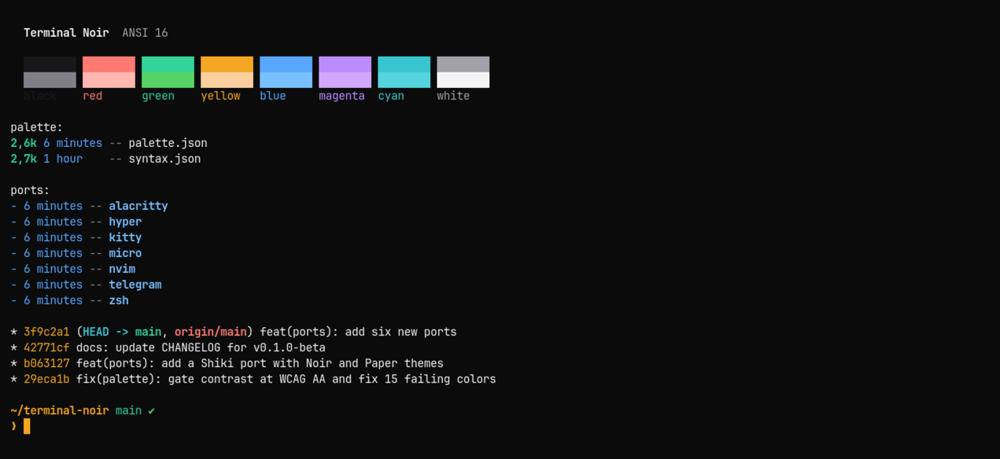

# Terminal Noir for Alacritty

[Alacritty](https://alacritty.org) color files: `terminal-noir.toml` (dark) and `terminal-noir-paper.toml` (light), with the amber cursor, search matches and hints.



## Install

```sh
mkdir -p ~/.config/alacritty
cp terminal-noir.toml terminal-noir-paper.toml ~/.config/alacritty/
```

Import one of them in `~/.config/alacritty/alacritty.toml`:

```toml
[general]
import = ["~/.config/alacritty/terminal-noir.toml"]
```

Alacritty reloads the config on save.
