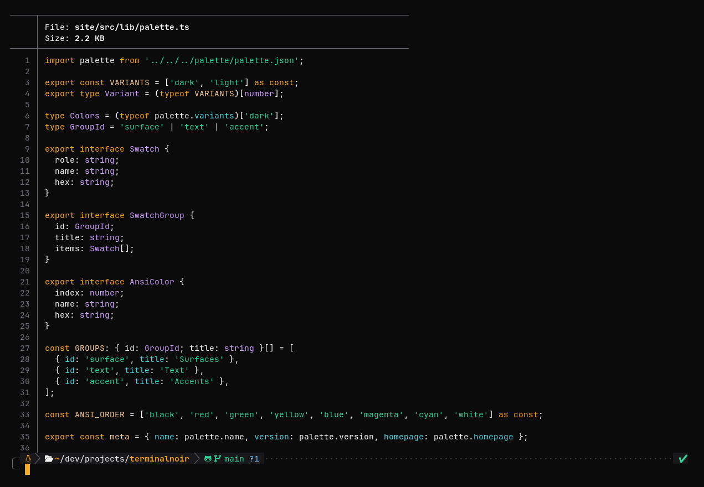

# Terminal Noir para bat

Um tema de sintaxe para o [bat](https://github.com/sharkdp/bat), no formato TextMate.



## Instalação

```sh
mkdir -p "$(bat --config-dir)/themes"
cp "Terminal Noir.tmTheme" "$(bat --config-dir)/themes/"
bat cache --build
```

Use com `--theme="Terminal Noir"` em `$(bat --config-dir)/config`, ou com `export BAT_THEME="Terminal Noir"`.

O [delta](https://github.com/dandavison/delta) lê os temas do bat: defina `syntax-theme = Terminal Noir` na seção `[delta]` da sua configuração do git.
