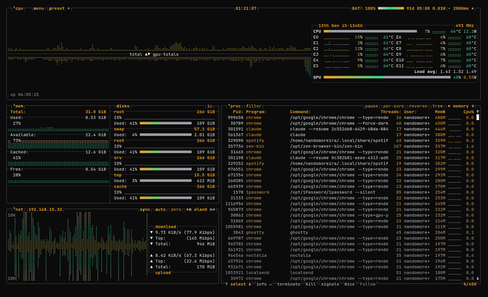

# Terminal Noir para btop

Um tema de cores para o [btop](https://github.com/aristocratos/btop): títulos em âmbar, caixas com contorno e gradientes de carga que vão do esmeralda ao rosa, passando pelo creme.



## Instalação

```sh
mkdir -p ~/.config/btop/themes
cp terminal-noir.theme ~/.config/btop/themes/
```

Depois escolha o tema nas opções do btop (Esc > Options > Color theme), ou defina `color_theme = "terminal-noir"` em `~/.config/btop/btop.conf`.
