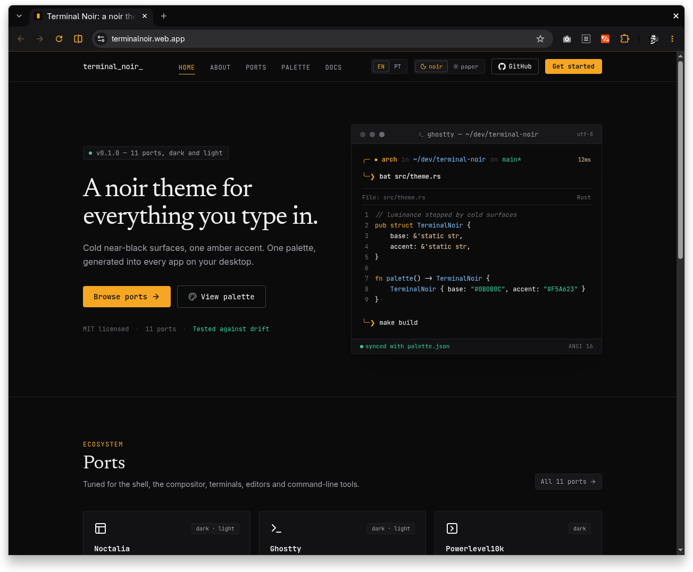

# Terminal Noir for Google Chrome

A browser theme (frame, tabs, toolbar, address bar, new tab page). Chrome themes have no light variant.

## Install

1. Open `chrome://extensions` and turn on Developer mode.
2. Click "Load unpacked" and pick this `ports/chrome` folder.

The theme stays after restarts. After `make build` changes it, click reload on the extension card.
