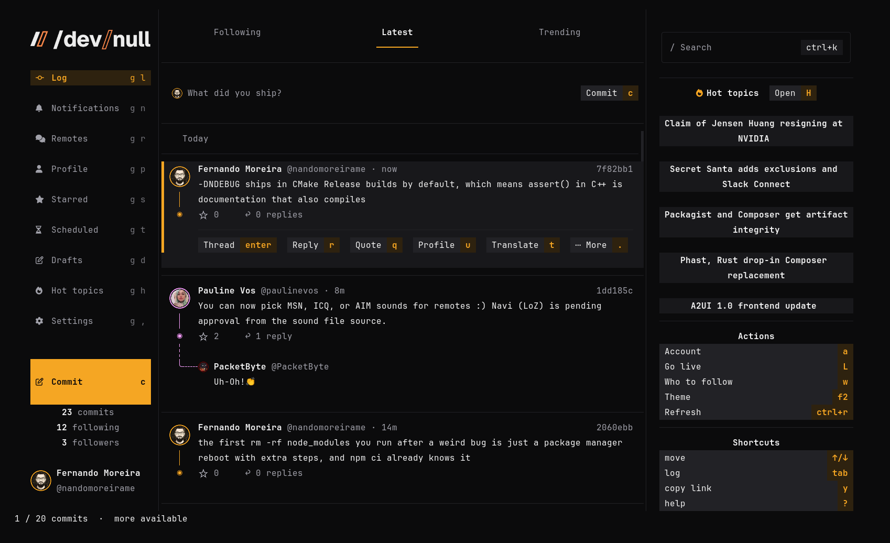

# Terminal Noir for /dev/null

A color theme for the [/dev/null](https://dev-null.sh) terminal client (`devnull`): cold near-black surfaces, amber highlights and the palette's hues for the six chart lanes. `terminal-noir.json` is the dark theme and `terminal-noir-paper.json` the light one.



## Install

The app keeps its own `tui.json` and rewrites it, so merge the theme in instead of linking the file:

```sh
config=~/.config/dev-null-cli/tui.json
jq -s '.[0] * {custom_themes: ((.[0].custom_themes // []) + [.[1:][].custom_themes[]] | unique_by(.name))}' \
  "$config" terminal-noir.json terminal-noir-paper.json > "$config.new" \
  && mv "$config.new" "$config"
```

Then pick Terminal Noir in the theme picker (F2), or set `"theme": "custom:Terminal Noir"` in `tui.json`. For the light theme use `"custom:Terminal Noir Paper"`.
