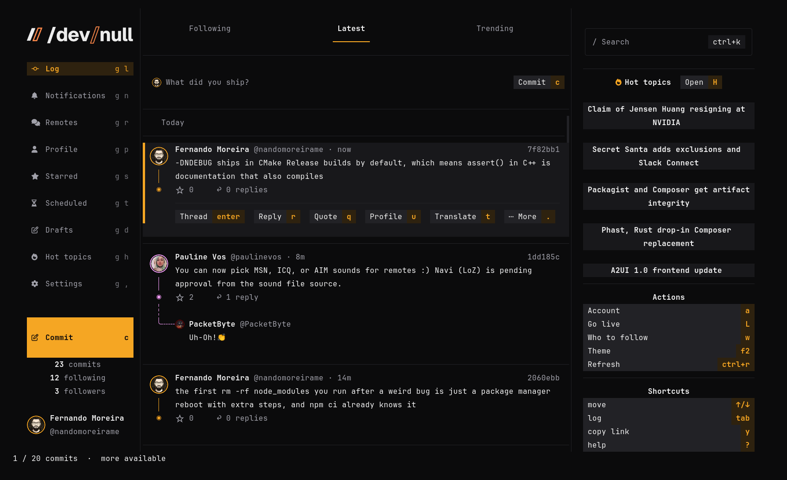

# Terminal Noir para /dev/null

Um tema de cores para o cliente de terminal do [/dev/null](https://dev-null.sh) (`devnull`): superfícies quase pretas e frias, destaques em âmbar e as cores da paleta nas seis faixas dos gráficos. `terminal-noir.json` é o tema escuro e `terminal-noir-paper.json` o claro.



## Instalação

O app mantém o próprio `tui.json` e o reescreve, então mescle o tema em vez de criar um link para o arquivo:

```sh
config=~/.config/dev-null-cli/tui.json
jq -s '.[0] * {custom_themes: ((.[0].custom_themes // []) + [.[1:][].custom_themes[]] | unique_by(.name))}' \
  "$config" terminal-noir.json terminal-noir-paper.json > "$config.new" \
  && mv "$config.new" "$config"
```

Depois escolha Terminal Noir no seletor de temas (F2), ou defina `"theme": "custom:Terminal Noir"` no `tui.json`. Para o tema claro use `"custom:Terminal Noir Paper"`.
