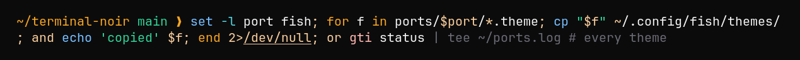

# Terminal Noir for fish

A [fish](https://fishshell.com) theme with blue commands, amber keywords, emerald strings and a faint autosuggestion. One file holds both variants: fish picks the light or dark section to match your terminal background.



## Install

Copy the theme and choose it:

```sh
mkdir -p ~/.config/fish/themes
cp terminal-noir.theme ~/.config/fish/themes/
fish_config theme choose terminal-noir
```

Running `fish_config theme save terminal-noir` instead stores the colors as universal variables, shared by every fish session.
