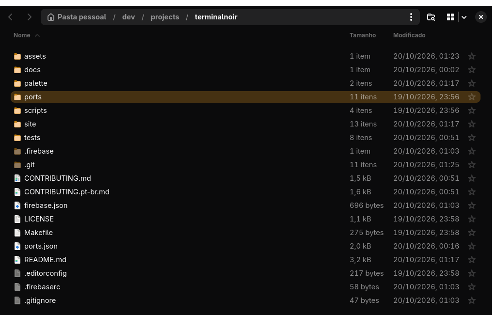

# Terminal Noir for GTK 4 / libadwaita

Dark colors and the amber accent for GTK 4 and libadwaita apps (Nautilus, file chooser, settings dialogs), plus an icon theme with amber folders.



## Colors and accent

```sh
cp gtk.css ~/.config/gtk-4.0/gtk.css     # or @import it from your own gtk.css
```

libadwaita 1.6+ takes the accent from the system preset through CSS variables; `gtk.css` sets them to the exact amber. Set the preset to the closest one too, for apps that only read the portal:

```sh
gsettings set org.gnome.desktop.interface color-scheme prefer-dark
gsettings set org.gnome.desktop.interface accent-color orange
```

Nautilus and the file chooser force a grey accent in file lists; `gtk.css` overrides that so selection and focus are amber.

## Amber folders

Adwaita's folder icons are a fixed blue. `scripts/build-gtk-icons` builds a `Terminal-Noir` icon theme from the installed Adwaita, recoloring only the folders:

```sh
scripts/build-gtk-icons            # writes ~/.local/share/icons/Terminal-Noir
gsettings set org.gnome.desktop.interface icon-theme Terminal-Noir
```

Rerun it after an `adwaita-icon-theme` update. Reopen GTK apps to see the changes.
