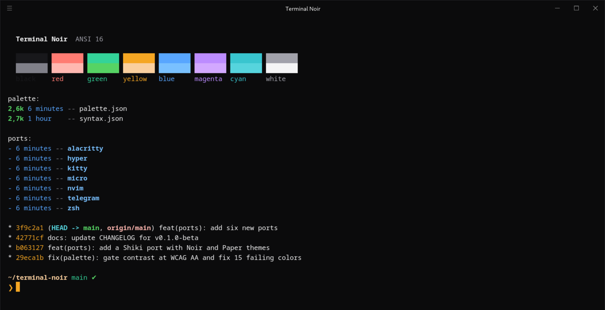

# Terminal Noir para Hyper

Um plugin para o [Hyper](https://hyper.is) que pinta o terminal, as abas e o cursor. Escuro por padrão; defina `variant: 'paper'` para o claro.



## Instalação

Copie o plugin para a pasta de plugins locais do Hyper, ao lado do seu `.hyper.js` (`~/Library/Application Support/Hyper` no macOS):

```sh
mkdir -p ~/.config/Hyper/.hyper_plugins/local/hyper-terminal-noir
cp package.json index.js ~/.config/Hyper/.hyper_plugins/local/hyper-terminal-noir/
```

Depois ative-o no `.hyper.js` (`Ctrl+,` abre o arquivo):

```js
module.exports = {
  config: {
    terminalNoir: { variant: 'noir' }, // or 'paper'
  },
  localPlugins: ['hyper-terminal-noir'],
};
```

Recarregue com `Ctrl+Shift+R`.
