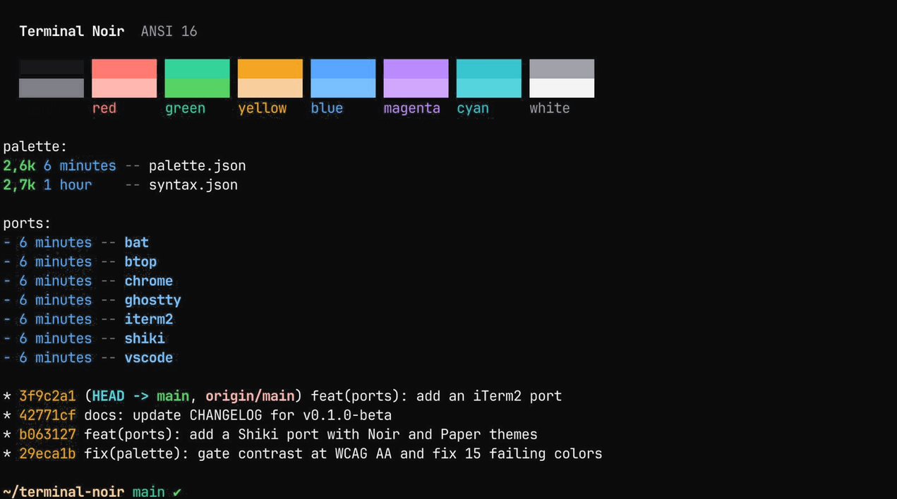

# Terminal Noir para iTerm2

Presets de cores para o [iTerm2](https://iterm2.com), nas variantes escura e clara: `Terminal Noir.itermcolors` e `Terminal Noir Paper.itermcolors`.



## Instalação

Importe os dois presets pelo terminal:

```sh
open "Terminal Noir.itermcolors" "Terminal Noir Paper.itermcolors"
```

Ou vá em **Settings > Profiles > Colors > Color Presets... > Import...** e escolha os dois arquivos. Depois selecione **Terminal Noir** no mesmo menu.

Para seguir a aparência do macOS, marque **Use different colors for Light and Dark mode** na aba Colors, carregue **Terminal Noir** editando o lado Dark e **Terminal Noir Paper** editando o lado Light.
