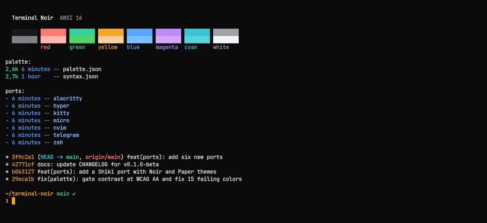

# Terminal Noir para kitty

Temas para o [kitty](https://sw.kovidgoyal.net/kitty/): `terminal-noir.conf` (escuro) e `terminal-noir-paper.conf` (claro), com abas, bordas e cursor em âmbar.



## Instalação

```sh
mkdir -p ~/.config/kitty/themes
cp terminal-noir.conf terminal-noir-paper.conf ~/.config/kitty/themes/
kitten themes --reload-in=all "Terminal Noir"
```

Para seguir a preferência clara ou escura do sistema, copie cada arquivo para os nomes que o kitty observa:

```sh
cp terminal-noir.conf ~/.config/kitty/dark-theme.auto.conf
cp terminal-noir-paper.conf ~/.config/kitty/light-theme.auto.conf
```
