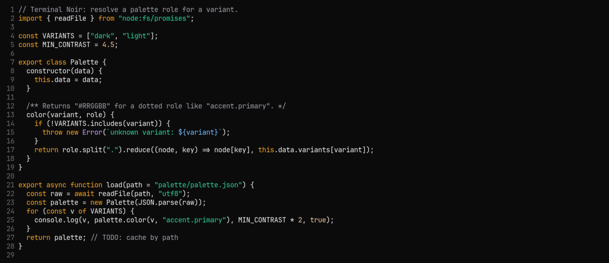

# Terminal Noir para micro

Esquemas de cores para o editor [micro](https://micro-editor.github.io): `terminal-noir.micro` (escuro) e `terminal-noir-paper.micro` (claro), com palavras-chave em âmbar, strings em esmeralda e funções em azul.



## Instalação

```sh
mkdir -p ~/.config/micro/colorschemes
cp terminal-noir.micro terminal-noir-paper.micro ~/.config/micro/colorschemes/
```

No micro, aperte `Ctrl+E` e rode `set colorscheme terminal-noir`. As cores são hex de 24 bits, então defina `MICRO_TRUECOLOR=1` se a sua versão do micro não detectar true color.
