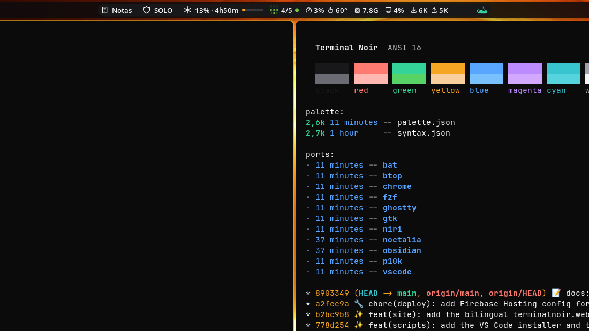

# Terminal Noir para niri

Decoração de janelas para o [niri](https://github.com/niri-wm/niri): anel de foco em âmbar com 80% de opacidade, contorno cinza nas janelas sem foco, rosa de erro nas urgentes e uma indicação de inserção em âmbar.



## Instalação

Copie os blocos `focus-ring`, `border` e `insert-hint` do `terminal-noir.kdl` para a seção `layout {}` do `~/.config/niri/config.kdl` e confira:

```sh
niri validate
```

O niri recarrega o `config.kdl` ao salvar.
