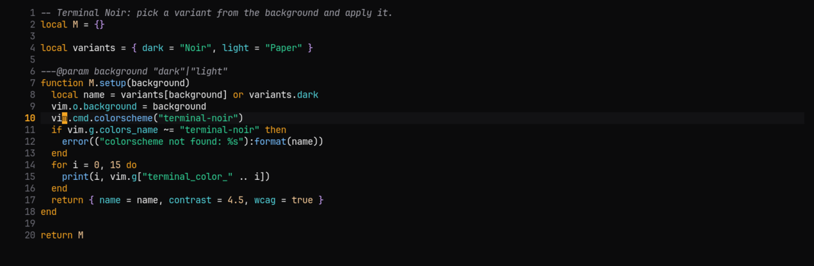

# Terminal Noir for Neovim and Vim

Colorschemes for [Neovim](https://neovim.io) (`colors/terminal-noir.lua`, with Tree-sitter, LSP, diagnostics, GitSigns and Telescope groups) and [Vim](https://www.vim.org) (`vim/colors/terminal-noir.vim`). Both follow `background`: dark gives Noir, light gives Paper.



## Install

Copy the Lua colorscheme into your config:

```sh
mkdir -p ~/.config/nvim/colors
cp colors/terminal-noir.lua ~/.config/nvim/colors/
```

Then pick it in `init.lua`:

```lua
vim.o.background = 'dark' -- or 'light' for Paper
vim.cmd.colorscheme('terminal-noir')
```

In Vim, copy `vim/colors/terminal-noir.vim` to `~/.vim/colors/` and add `set termguicolors` and `colorscheme terminal-noir` to your `.vimrc`.
