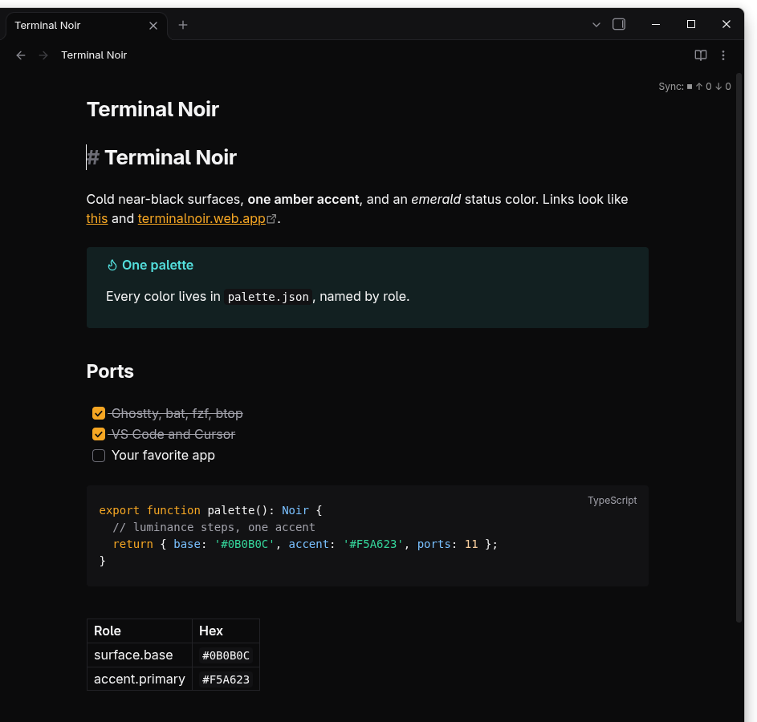

# Terminal Noir para Obsidian

Um tema do Obsidian para o modo escuro: painéis quase pretos, links e acento em âmbar, e blocos de código com as mesmas cores dos ports de editor.

## Instalação

1. Copie a pasta `Terminal Noir` para `<seu cofre>/.obsidian/themes/`.
2. No Obsidian: Configurações > Aparência, defina o Tema base como Escuro e escolha Terminal Noir em Temas.

A pasta é um tema de comunidade padrão (`manifest.json` + `theme.css`), então também pode ser carregada a partir de um fork do [obsidian-releases](https://github.com/obsidianmd/obsidian-releases) depois de publicada.
