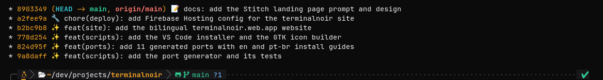

# Terminal Noir para Powerlevel10k

Sobrescritas de cor para o [Powerlevel10k](https://github.com/romkatv/powerlevel10k), pensadas para os estilos classic e rainbow.



## Instalação

No `.zshrc`, carregue as sobrescritas logo depois da sua configuração do p10k:

```zsh
[[ -f ~/.p10k.zsh ]] && source ~/.p10k.zsh
source /path/to/terminalnoir/ports/p10k/terminal-noir.p10k.zsh
```

Abra um shell novo (ou rode `exec zsh`).

Os detalhes do status do git (`!3 ?1`) são coloridos dentro do `my_git_formatter` no `~/.p10k.zsh`, onde um arquivo externo não alcança. Para cobrir tudo, troque as cores `meta`, `clean`, `modified`, `untracked` e `conflicted` dele por `%F{#A1A1AA}`, `%F{#34D399}`, `%F{#FACF9E}`, `%F{#79C0FF}` e `%F{#FFB7B0}`.
