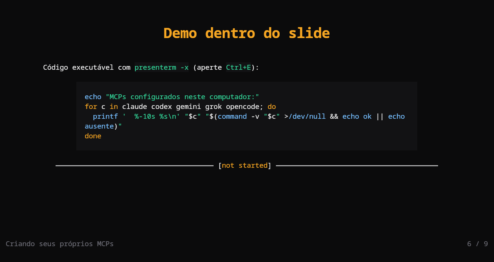

# Terminal Noir for presenterm

[presenterm](https://github.com/mfontanini/presenterm) slide themes: `terminal-noir.yaml` (dark) and `terminal-noir-paper.yaml` (light), each with a matching code highlighting theme that sets code blocks on the raised surface.



## Install

Copy the slide themes and the code themes into presenterm's config directory:

```sh
mkdir -p ~/.config/presenterm/themes/highlighting
cp terminal-noir.yaml terminal-noir-paper.yaml ~/.config/presenterm/themes/
cp terminal-noir.tmTheme terminal-noir-paper.tmTheme ~/.config/presenterm/themes/highlighting/
```

Pick a theme per run, per presentation or as the default:

```sh
presenterm -t terminal-noir slides.md
```

```yaml
---
theme:
  name: terminal-noir
---
```

```yaml
# ~/.config/presenterm/config.yaml
defaults:
  theme: terminal-noir
```

Slide titles are drawn at 2x and the intro title at 3x on terminals that support kitty's text sizing protocol, such as kitty. Other terminals, Ghostty included, draw them at normal size.
