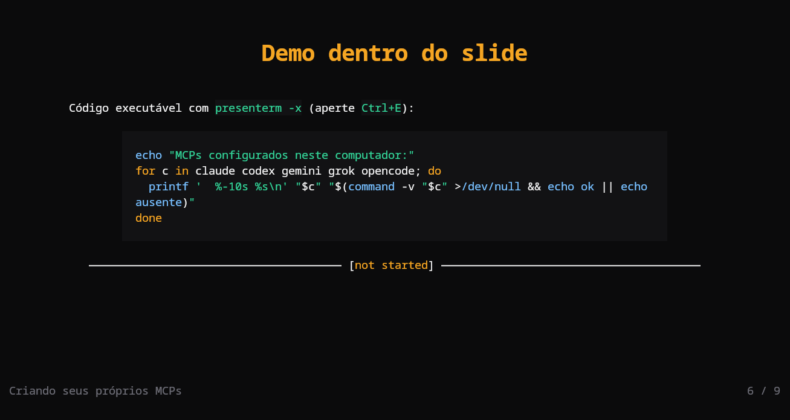

# Terminal Noir para presenterm

Temas de slides para o [presenterm](https://github.com/mfontanini/presenterm): `terminal-noir.yaml` (escuro) e `terminal-noir-paper.yaml` (claro), cada um com um tema de realce de código que põe os blocos de código na superfície elevada.



## Instalação

Copie os temas de slides e os temas de código para a pasta de configuração do presenterm:

```sh
mkdir -p ~/.config/presenterm/themes/highlighting
cp terminal-noir.yaml terminal-noir-paper.yaml ~/.config/presenterm/themes/
cp terminal-noir.tmTheme terminal-noir-paper.tmTheme ~/.config/presenterm/themes/highlighting/
```

Escolha o tema por execução, por apresentação ou como padrão:

```sh
presenterm -t terminal-noir slides.md
```

```yaml
---
theme:
  name: terminal-noir
---
```

```yaml
# ~/.config/presenterm/config.yaml
defaults:
  theme: terminal-noir
```

Os títulos dos slides saem em 2x e o título de abertura em 3x nos terminais com o protocolo de tamanho de texto do kitty, como o próprio kitty. Os outros terminais, incluindo o Ghostty, desenham esses títulos no tamanho normal.
