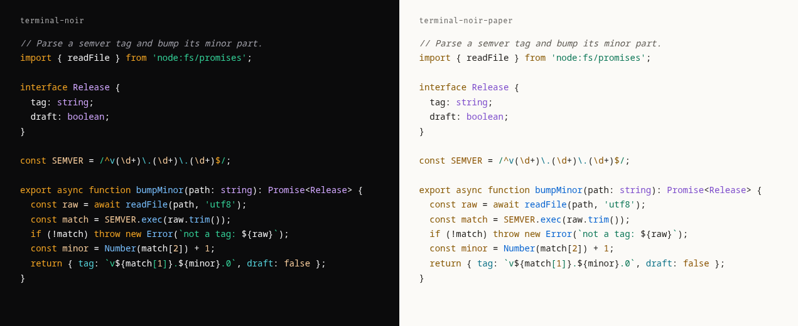

# Terminal Noir for Shiki

[Shiki](https://shiki.style) themes for code on websites: `terminal-noir.json` (dark) and `terminal-noir-paper.json` (light). Every token clears WCAG AA on the theme's background.



## Install

Copy both files next to your config, then pass them as theme objects:

```js
import noir from './terminal-noir.json' with { type: 'json' };
import paper from './terminal-noir-paper.json' with { type: 'json' };

const html = await codeToHtml(code, { lang: 'ts', themes: { dark: noir, light: paper } });
```

In Astro, set `markdown.shikiConfig.themes` to `{ dark: noir, light: paper }`. With `defaultColor: false`, Shiki writes `--shiki-dark` and `--shiki-light` variables and your CSS picks one.
