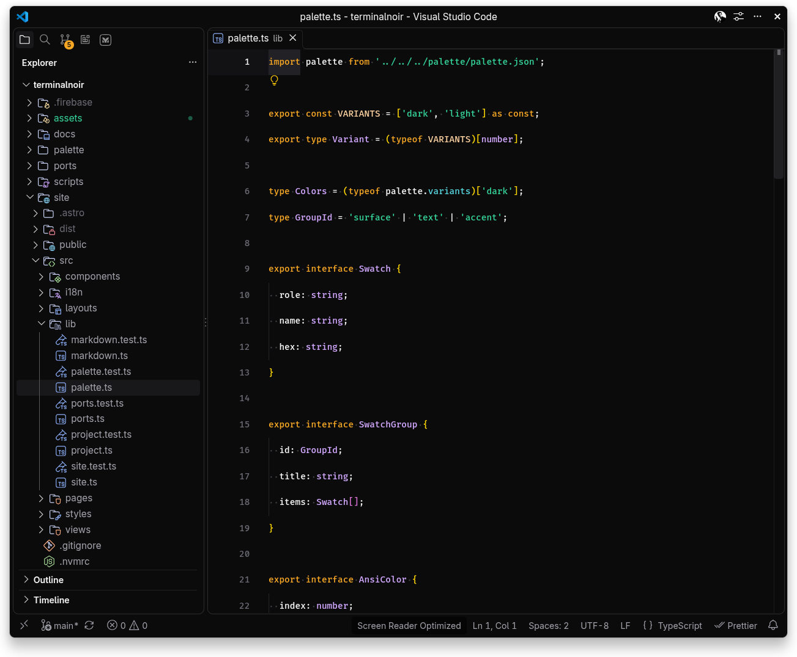

# Terminal Noir para VS Code e Cursor

Uma extensão de tema escuro: interface do editor, terminal integrado e destaque de sintaxe.



## Instalação

Na raiz do repositório:

```sh
scripts/install-vscode   # packages a .vsix and installs it in VS Code and Cursor
```

Depois selecione: Preferências > Tema de cores > Terminal Noir, ou no `settings.json`:

```json
"workbench.colorTheme": "Terminal Noir"
```

As versões atuais do VS Code e do Cursor ignoram uma pasta solta em `~/.vscode/extensions`: elas só carregam extensões registradas por `--install-extension`. Rode o script de novo depois que o `make build` mudar o tema.
