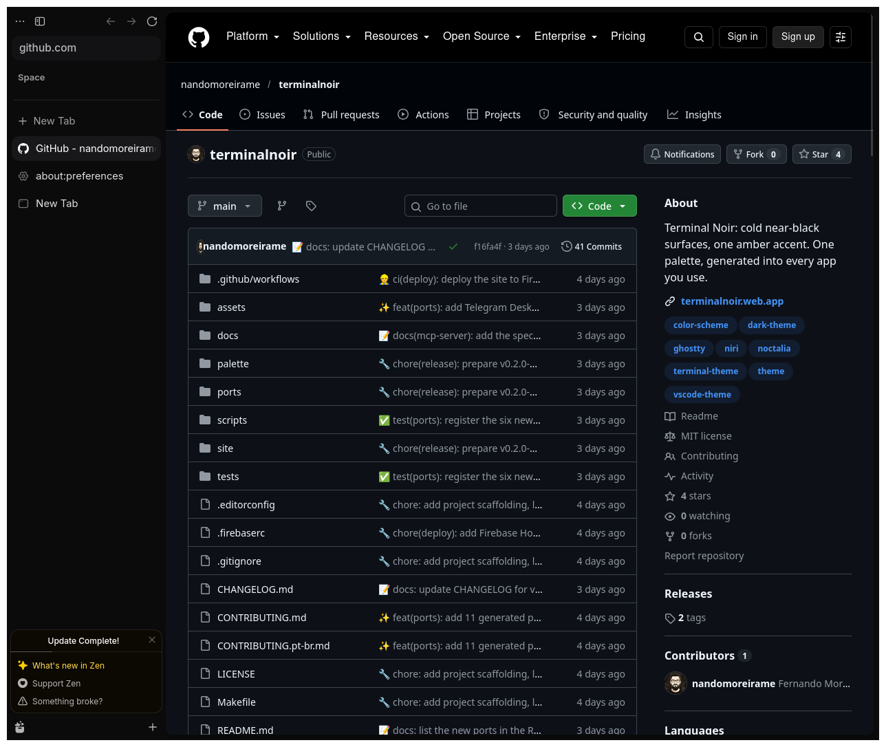

# Terminal Noir for Zen Browser

A Zen Browser theme with near-black Noir surfaces or warm Paper tones, amber accents, and matching internal pages.

## Install

1. Open `about:config` and set `toolkit.legacyUserProfileCustomizations.stylesheets` to `true`.
2. Open `about:support` and click "Open Folder" next to "Profile Folder".
3. Create a `chrome` folder there and copy `userChrome.css` and `userContent.css` into it. If the files already exist, append their contents.
4. Restart Zen.

The theme replaces the workspace gradient. Zen's Settings > Look and Feel dark, light, or auto choice selects Noir or Paper.
