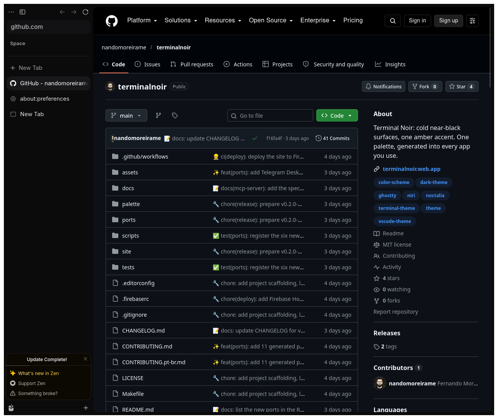

# Terminal Noir para Zen Browser

Um tema para Zen Browser com superfícies quase pretas no Noir ou tons quentes de papel no Paper, acentos em âmbar e páginas internas com as mesmas cores.

## Instalação

1. Abra `about:config` e defina `toolkit.legacyUserProfileCustomizations.stylesheets` como `true`.
2. Abra `about:support` e clique em "Abrir pasta" ao lado de "Pasta do perfil".
3. Crie uma pasta `chrome` nesse local e copie `userChrome.css` e `userContent.css` para ela. Se os arquivos já existirem, acrescente o conteúdo ao final deles.
4. Reinicie o Zen.

O tema substitui o gradiente do espaço de trabalho. A opção escuro, claro ou automático em Configurações > Aparência do Zen seleciona Noir ou Paper.
