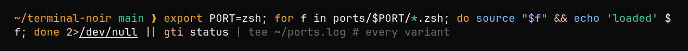

# Terminal Noir para zsh

Cores da linha de comando para o [zsh](https://www.zsh.org): estilos do [zsh-syntax-highlighting](https://github.com/zsh-users/zsh-syntax-highlighting) com comandos em azul, palavras-chave em âmbar e strings em esmeralda, e uma sugestão discreta do [zsh-autosuggestions](https://github.com/zsh-users/zsh-autosuggestions). `terminal-noir.zsh` é a variante escura e `terminal-noir-paper.zsh`, a clara.



## Instalação

Carregue um dos arquivos no seu `.zshrc`:

```sh
source /path/to/terminalnoir/ports/zsh/terminal-noir.zsh
```

A ordem em relação aos plugins não importa. As cores são hex de 24 bits, então o terminal precisa de true color (Ghostty, iTerm2, kitty, WezTerm e a maioria dos terminais modernos têm).
